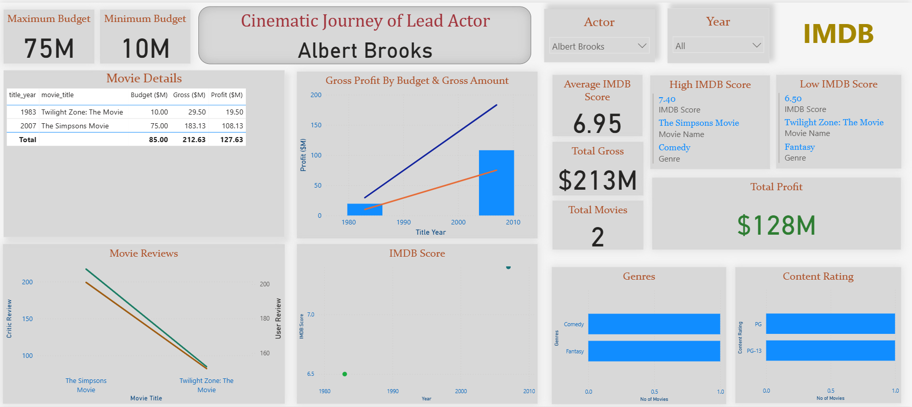
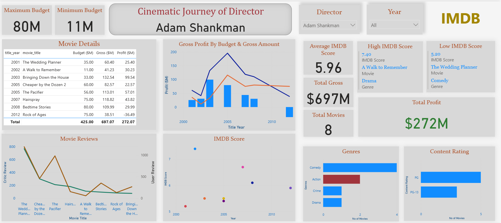
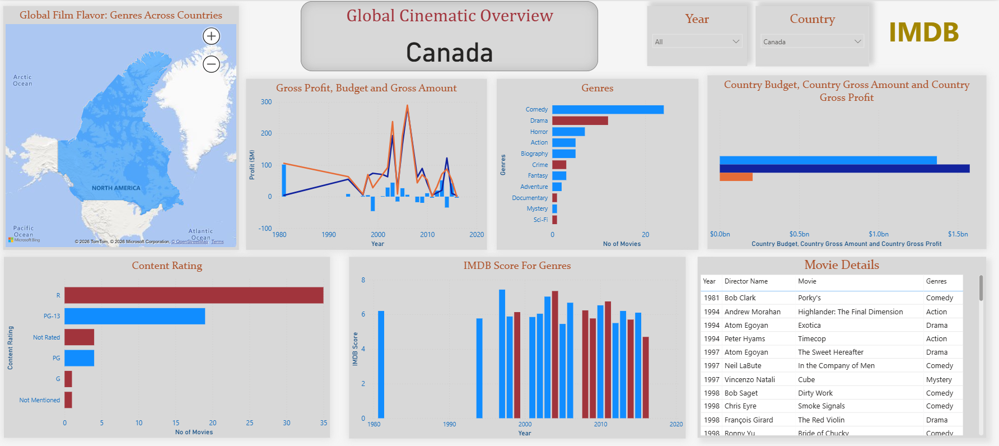

# IMDB Movie Analytics — Power BI Dashboard

An interactive Power BI report that explores **3,789 movies (1920–2016)** from the IMDB 5000 dataset — how actors, directors and countries perform on budget, box-office gross, profit and IMDB ratings.

**Tools:** Python (Pandas) for cleaning · Power BI (Power Query, DAX, data modelling) for the dashboard

---

## Business questions

1. How has an actor's or director's career moved over time — budgets, earnings, ratings and reviews?
2. Which genres and content ratings does each actor, director and country work in most?
3. Do higher-rated movies actually make more money?
4. Which countries produce the most films, and how profitable are they?

## Dashboard

### 1. Cinematic Journey of an Actor
Pick a lead actor and a year range to see every film they headlined, gross profit against budget, critic and user reviews, IMDB scores, genres, content ratings, their best and worst-rated film, and their highest and lowest budgets.

### 2. Cinematic Journey of a Director
The same view for directors, with a budget / gross / profit table for each film.

### 3. Global Cinematic Overview
Country-level view: a map of genres across countries, profit over time, genre and content-rating mix, and IMDB scores by genre.

## Data preparation

Done in [`IMDB.ipynb`](IMDB.ipynb):

- Removed 45 duplicate rows and repeated movie titles
- Dropped movies with no budget or gross (needed for profit) — **5,043 → 3,789 movies**
- Filled missing content ratings with `Not Mentioned`
- Built a **star-schema model** in Power BI: a `Fact` movie table linked to dimension tables for **lead actor**, **director**, **primary genre**, **country**, **language** and **content rating**
- Added a **Gross Profit = Gross − Budget** column and DAX measures for movie counts, average IMDB score, best/worst-rated film and budgets in $M

## Key insights

- **Ratings pay off.** Median profit for movies rated **8+ is about $30M**, for 7–8 about $7M, while movies rated below 6 typically **lose money**.
- **Only about half (52%) of movies made a profit** on their budget.
- **Bigger budget ≠ bigger box office.** Budget and gross are only weakly correlated (r ≈ 0.22).
- **Drama is the most common genre** (1,913 films) and has the highest average rating (6.8), but its median profit is slightly negative. **Family, Horror and Fantasy** films have the best median profits; Horror has the lowest average rating (5.9).
- **The USA makes up 79%** of movies in the dataset, so country comparisons are heavily US-weighted.

## Data limitation

Budgets for many non-US films are recorded in **local currency, not US dollars** — for example *Lady Vengeance* (South Korea) shows a budget of 4.2 billion, which is in Korean won. This makes non-US budgets and profits look far bigger than they are, so country-level budget and profit numbers should be read with care. A future version could convert budgets to USD or limit money comparisons to US films.

The model also links each movie to its **lead actor** and **primary (first-listed) genre** only, so supporting roles and secondary genres are not counted.

## Files

| File | Description |
|---|---|
| `IMDB.pbix` | Power BI report |
| `IMDB Report.pdf` | PDF export of the dashboard |
| `IMDB.ipynb` | Python data cleaning notebook |
| `IMDB_Movies.csv` | Source dataset (IMDB 5000 Movie Dataset) |

---

**Uma Maheswari Pushparaj** · Data Analyst · Microsoft Certified: Power BI Data Analyst Associate (PL-300)
